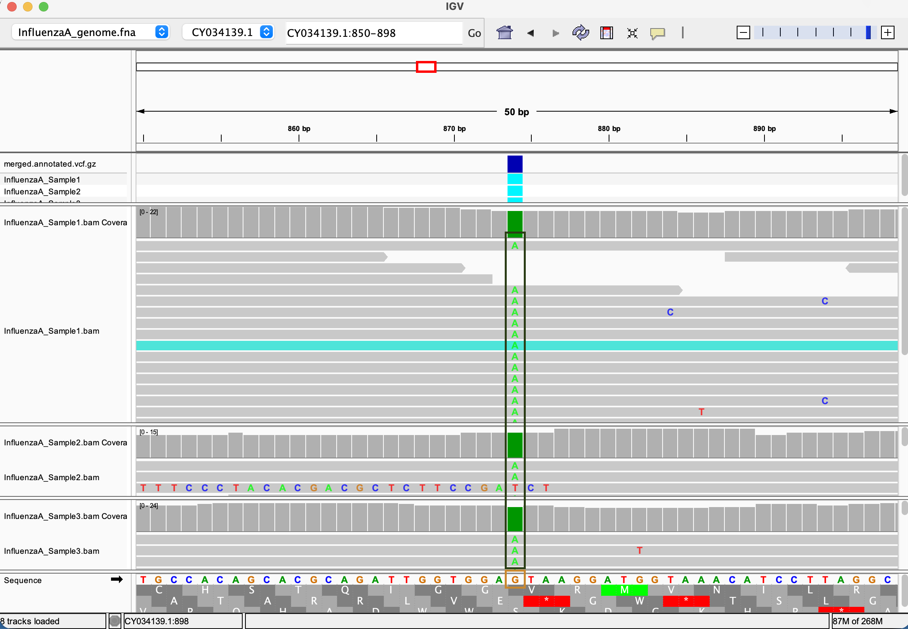

# Multi-sample VCF and Variant Effect Prediction — Influenza A 

## 1. Overview

This directory contains a reproducible Makefile pipeline that:

1. Downloads a reference genome and gene-model annotation (GFF) for Influenza A
   virus (A/WSN/1933(H1N1)), assembly `GCA_037915055.1` (`ASM3791505v1`).
2. Downloads paired-end RNA-seq reads from SRA for three biological samples,
   subsets them to a target coverage, and aligns them to the reference with `bwa mem`.
3. Calls variants per sample with `bcftools mpileup` / `bcftools call` (haploid,
   `PLOIDY=1`.
4. Merges the three per-sample VCFs into a single multi-sample VCF with `bcftools merge`.
5. Annotates variant effects on the merged VCF using `bcftools csq` (reference
   FASTA + patched GFF), producing gene, consequence, codon, and amino-acid
   change information for each variant.
6. Extracts only the variants that fall in coding regions for manual review.

All steps are automated in `Makefile`; no manual editing of intermediate files
is required other than the one-time environment setup described below.

## 2. Samples used

| Sample name            | SRR accession   | Data type        |
|-------------------------|-----------------|-------------------|
| InfluenzaA_Sample1       | SRR31107661    | Paired-end RNA-seq |
| InfluenzaA_Sample2       | SRR31107658    | Paired-end RNA-seq |
| InfluenzaA_Sample3       | SRR31107659    | Paired-end RNA-seq |


Reference genome: `GCA_037915055.1` / `ASM3791505v1`, Influenza A virus
(A/WSN/1933(H1N1)).

Reads are RNA-seq because Influenza A has an RNA genome.

## 3. Environment setup

This pipeline requires the following command-line tools: `curl`, `gzip`,
`prefetch` and `fasterq-dump` (sra-tools), `bwa`, `samtools`, `bcftools`.

Create the environment once with conda, using the provided `environment.yml`:

```bash
conda env create --prefix ./.bioinfo-env --file environment.yml
```

The Makefile automatically looks for tools in `./.bioinfo-env/bin`. If your
tools are installed elsewhere (e.g. an already-active conda/mamba
environment), point to it explicitly:

```bash
make all TOOLS_DIR=/path/to/your/env/bin ...
```

## 4. Reproducing the results

Run once per sample (downloads the shared reference genome only on the first
call), then merge and annotate:

```bash
# Per-sample: align + call variants
make all SRR_ACCESSION=SRR31107661 SAMPLE_NAME=InfluenzaA_Sample1
make all SRR_ACCESSION=SRR31107658 SAMPLE_NAME=InfluenzaA_Sample2
make all SRR_ACCESSION=SRR31107659 SAMPLE_NAME=InfluenzaA_Sample3

# Download and patch the gene-model annotation (GFF) once
make annotation

# Merge the three per-sample VCFs into one multi-sample VCF
make merge SAMPLES="InfluenzaA_Sample1 InfluenzaA_Sample2 InfluenzaA_Sample3"

# Annotate variant effects (gene / consequence / codon / amino-acid change)
make annotate SAMPLES="InfluenzaA_Sample1 InfluenzaA_Sample2 InfluenzaA_Sample3"

# Extract only variants that fall in coding regions
make coding SAMPLES="InfluenzaA_Sample1 InfluenzaA_Sample2 InfluenzaA_Sample3"
```

Key outputs:

| File | Description |
|---|---|
| `genome/InfluenzaA_genome.fna` | Reference genome (8 segments) |
| `genome/InfluenzaA_genomic.gff` | Patched gene-model annotation used by `bcftools csq` |
| `align/<sample>.bam` | Sorted, indexed alignment per sample |
| `variants/<sample>.vcf.gz` | Per-sample variant calls |
| `variants/merged.vcf.gz` | Multi-sample VCF (3 samples) |
| `variants/merged.annotated.vcf.gz` | Annotated VCF with `INFO/BCSQ` effect tags |
| `reports/coding_variants.txt` | Variants restricted to coding regions |


## 5. Annotated variants

Variants below were selected from `reports/coding_variants.txt` because they
fall within a coding sequence and are non-synonymous (missense).

### Variant 1

| Field | Value |
|---|---|
| Segment / chromosome | CY034139.1 |
| Position | 874 |
| Gene | Polymerase basic protein 2 (PB2) |
| Reference allele -> Alternate allele | G -> A |
| Amino acid change | Valine to Isoleucine (292V>292I)|
| Predicted consequence (bcftools csq) | missense |

`bcftools csq` raw output (`INFO/BCSQ`):

```
#CHROM	POS	ID	REF	ALT	QUAL	FILTER	INFO	FORMAT	InfluenzaA_Sample1	InfluenzaA_Sample2	InfluenzaA_Sample3
CY034139.1	874	.	G	A	225.417	.	VDB=0.139238;SGB=-0.686358;MQSBZ=0;MQ0F=0;MQ=60;DP=49;DP4=0,0,21,17;AN=3;AC=3;BCSQ=missense|PB2|mrna_cds-ACF54608.1|protein_coding|+|292V>292I|874G>A	GT:PL:DP:AD:BCSQ	1:255,0:14:0,14:1	1:255,0:9:0,9:1	1:255,0:15:0,15:1
```

### Variant 2

| Field | Value |
|---|---|
| Segment / chromosome | CY034138.1 |
| Gene | Polymerase basic protein 1 (PB1) |
| Position | 758 |
| Reference allele -> Alternate allele | T -> G |
| Amino acid change | Phenylalanine to Cysteine (251F>251C) |
| Predicted consequence (bcftools csq) | missense |

```
#CHROM	POS	ID	REF	ALT	QUAL	FILTER	INFO	FORMAT	InfluenzaA_Sample1	InfluenzaA_Sample2	InfluenzaA_Sample3
CY034138.1	758	.	T	G	158.918	.	VDB=0.791433;SGB=-0.651104;RPBZ=1.30558;MQBZ=0;MQSBZ=0;BQBZ=-0.271163;SCBZ=0;MQ0F=0;MQ=60;DP=13;DP4=0,2,4,4;AN=1;AC=1;BCSQ=missense|PB1|mrna_cds-ACF54606.1|protein_coding|+|251F>251C|758T>G	GT:PL:DP:AD:BCSQ	1:249,63:10:2,8:1	.:.:.:.:0	.:.:.:.:0
```

## 6. IGV verification

To visually confirm the call for variant 1 against the translated coding sequence, I used IGV. The codon change at genomic position CY034139.1:874 from GTA to ATA changed the amino acid from Valine to Isoleucine, as seen in IGV. The orange rectangle shows the reference genome nucleotide 'G', and the purple rectangle shows the sample's variant nucleotide 'A'.



## 7. Cleaning up

```bash
make clean
```

Removes all generated genome, fastq, alignment, variant, and report files.
