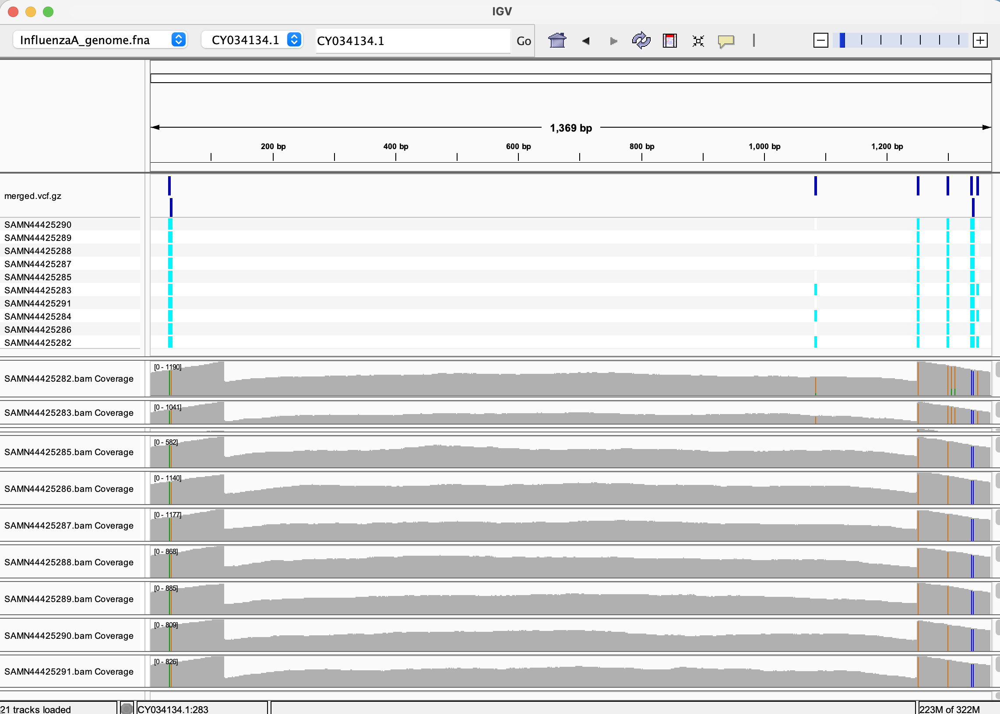

# Multi-Sample Variant Calling Pipeline

A `make`-driven pipeline that, from a single `design.csv`, downloads a
shared reference genome once, then for every sample in the design
file: downloads SRA reads (sized to a target coverage), aligns them,
and calls variants — all in parallel — before merging every sample's
calls into one multi-sample VCF and annotating coding-region effects.

---

## 1. BioProject Summary

| Field | Value |
|---|---|
| BioProject accession | PRJNA1177455 |
| Organism |  Influenza A virus (A/WSN/1933(H1N1))|
| Reference assembly used | GCA_037915055.1|
| Total runs in the BioProject | 17 |
| Samples used in this analysis | 10 |
| Sequencing platform / library layout | Illumina, paired-end |
| Project Title | Influenza A virus transcription generates capped cRNAs that activate RIG-I |

## 2. Environment Setup

```bash
conda env create --prefix ./.bioinfo-env --file environment.yml
```

## 3. Reproducing this workflow end to end

### Step 1 — confirm single-sample variant calling works

Before running the full batch, sanity-check the pipeline on one known
sample:

```bash
make single-all SRR_ACCESSION=SRR31107661 SAMPLE_NAME=Sample01 COVERAGE=100
```

### Step 2 — Get the `design.csv` from the BioProject

Get the design file from the BioProject [PRJNA1177455](https://www.ncbi.nlm.nih.gov/Traces/study/?acc=SRP540677&o=acc_s%3Aa).

### Step 3 — run the batch: fastq → align → variants, all 10 samples

```bash
make all COVERAGE=100
```

Because `design.csv` now exists, `make all` auto-detects it and runs
the **full multi-sample pipeline** in one command:

1. Downloads the shared reference genome + annotation once
   (`make genome annotation`)
2. For every row in `design.csv`, **in parallel** (`JOBS=4` by
   default, override with `JOBS=8` etc.): downloads reads sized to
   `BATCH_COVERAGE`, aligns,
   measures actual depth, and enforces `MIN_MEAN_DEPTH=10` before
   calling variants (`make single-all` per sample).
3. **Merges** all 10 per-sample VCFs.
4. **Annotates** coding effects with `bcftools csq`.
5. Writes `reports/coding_variants.txt` — only the variants that fall
   in a coding region.


## 4. Visualize results in IGV




## 5. Findings 

**Variant summary:**
| Metric | Value |
|---|---|
| Total variant sites (merged VCF) | 22 |
| SNPs | 21 |
| Indels | 1 |

## 6. Cleaning up

```bash
make clean
```

Removes `genome/`, `fastq/`, `align/`, `variants/`, `reports/`, and
`design/`. 

## Key parameters

| Variable | Default | Purpose |
|---|---|---|
| `Genome_Accession_Number` / `Genome_Accession_Name` | `GCA_037915055.1` / `ASM3791505v1` | Reference assembly to download |
| `ORG_NAME` | `InfluenzaA` | Label for shared genome/annotation files |
| `DESIGN_CSV` | `design.csv` | Path to the design file driving the batch |
| `BATCH_COVERAGE` | `100` | Target depth per sample in `make batch`/`make all` |
| `MIN_MEAN_DEPTH` | `10` | Minimum mean aligned depth enforced before calling variants (assignment requirement) |
| `JOBS` | `4` | Samples processed concurrently in `make batch` |
| `PLOIDY` | `1` | Haploid calling, appropriate for this viral reference |

## Command reference

| Command | What it does |
|---|---|
| `make help` | Print usage (also the default: bare `make`) |
| `make single-all SRR_ACCESSION=... SAMPLE_NAME=...` | Full pipeline for one sample |
| `make batch` | Run every row of `design.csv` in parallel |
| `make merge` | Combine per-sample VCFs into `variants/merged.vcf.gz` |
| `make annotate` | `bcftools csq` effect annotation on the merged VCF |
| `make coding` | List only coding-region variants |
| `make pipeline` | `batch` + `merge` + `annotate` + `coding` |
| `make all` | **Smart entry point** — runs `pipeline` if `design.csv` exists, else `single-all` |
| `make clean` | Remove all generated files |
