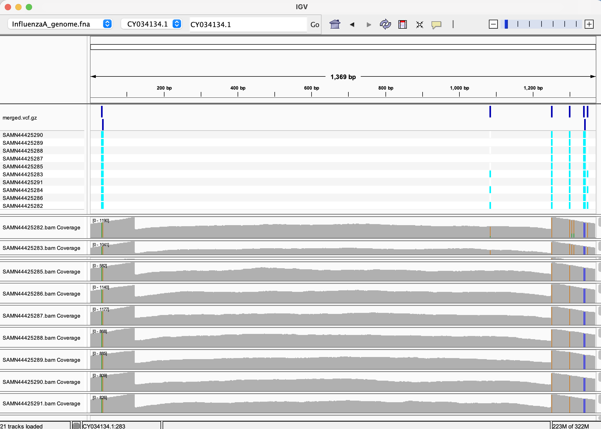

# Multi-Sample Variant Calling Pipeline

A Makefile-driven variant-calling pipeline for **single-sample** and **multi-sample** sequencing analysis. The Makefile processes one sample per invocation: it downloads up to 10,000 SRA spots per run by default, aligns them to a reference genome, checks sequencing depth, calls variants, and generates a per-sample VCF and summary statistics. For batch analysis, `scripts/run_parallel.sh` uses **GNU Parallel** to process a selected number of samples (`N`) from `design.csv` with a configurable number of concurrent jobs (`parallel`). The reference genome, annotation, and indexes are prepared once and shared by the sample jobs. Afterward, selected sample VCFs can be merged and annotated for coding-region effects.

## 1. BioProject Summary

| Field | Value |
|---|---|
| BioProject accession | PRJNA1177455 |
| Organism | Influenza A virus (A/WSN/1933(H1N1)) |
| Reference assembly used | GCA_037915055.1 |
| Total runs in the BioProject | 17 |
| Samples used in this analysis | 10 |
| Sequencing platform / library layout | Illumina, paired-end |
| Project Title | Influenza A virus transcription generates capped cRNAs that activate RIG-I |

## 2. Environment Setup

Create a Conda environment in the project directory:

```bash
conda env create --prefix ./.bioinfo-env --file environment.yml
conda activate ./.bioinfo-env
```

The environment should include Python, SRA Toolkit (`fastq-dump`), BWA, SAMtools, BCFtools, cURL, Entrez Direct (`esearch`, `efetch`), and **GNU Parallel**. Make sure `parallel` and `entrez-direct` are included in `environment.yml`.

## 3. Project Structure

```text
variant_pipeline/
├── Makefile
├── environment.yml
├── design.csv                      # Generated from the BioProject
├── scripts/
│   ├── download_design.sh          # Download SRA run metadata
│   ├── split_design.py             # Read Run/Sample columns and metadata
│   └── run_parallel.sh             # Select N samples and schedule jobs
├── genome/                         # Shared reference and annotation
├── fastq/                          # Sample FASTQ files
├── align/                          # Sample BAM files
├── variants/                       # Sample and merged VCFs
├── reports/                        # Per-sample stats, logs and summaries
└── design/                         # Selected-run lists for GNU Parallel
```

Output directories are generated during processing.

## 4. Reproducing the Workflow

### Step 1 — Download the design file

Download run metadata for the BioProject from NCBI:

```bash
make download-design BIOPROJECT=PRJNA1177455
```

This generates `design.csv`, containing sequencing run identifiers and available metadata. 

The parser recognizes the required `Run` column and either `Sample` or `BioSample`, matched **by column name**, regardless of column order or capitalization. Other columns are retained as metadata. Each selected sample name must be unique; if the same BioSample has multiple runs, assign distinct sample names before processing.

### Step 2 — Confirm single-sample variant calling works

Run one sample as a sanity check:

```bash
make all SRR_ACCESSION=SRR31107661 SAMPLE_NAME=Sample01
```

`make all` processes **one sample**, even if `design.csv` exists. `make single-all` is an equivalent single-sample entry point.

Variant calling requires a mean depth of at least `MIN_MEAN_DEPTH=10`; if the depth check fails, increase `NUM_READS` and rerun. For optional coverage-based read-count estimation, explicitly set `NUM_READS=`:

```bash
make all SRR_ACCESSION=SRR31107661 SAMPLE_NAME=Sample01 NUM_READS= COVERAGE=100 READ_LEN=50
```

For each sample, the pipeline downloads sequencing reads, aligns them to the genome, generates a sorted/indexed BAM, checks aligned depth, performs haploid variant calling, and writes a VCF and statistics report.

### Step 3 — Run 10 samples using four concurrent jobs

```bash
make design parallel=4 N=10
```

This command:

1. Reads `design.csv` and selects the first **10** valid sample rows.
2. Prepares the shared reference genome, GFF annotation, and indexes **once**.
3. Calls the existing single-sample Makefile workflow through GNU Parallel, with **up to four samples running concurrently**.
4. Downloads up to 10,000 spots per run by default. `NUM_READS` changes this limit; `BATCH_COVERAGE` and `BATCH_READ_LEN` affect read-count estimation only when `NUM_READS=` is explicitly set.
5. Generates per-sample FASTQ, BAM, VCF, coverage and statistics outputs, plus a GNU Parallel job log.

To change the sample count or concurrency:

```bash
make design parallel=8 N=10       # 10 total samples; up to 8 at once
make design parallel=4 N=all      # all rows in design.csv; up to 4 at once
make design parallel=2 N=5 NUM_READS=20000
```

**Important:** `N` is the **total number of samples selected**, while `parallel` is the **maximum number of concurrently running sample jobs**. The batch command does **not** automatically merge or annotate variants.

Relevant intermediate records include `design/.batch_rows.tsv`, `reports/sample_groups.tsv`, and `reports/parallel_joblog.tsv`.

### Step 4 — Merge and annotate the selected samples

After the ten sample jobs finish successfully, merge **only the samples selected in Step 3**:

```bash
SAMPLES="$(cut -f2 design/.batch_rows.tsv | paste -sd' ' -)"
make merge annotate coding SAMPLES="$SAMPLES"
```

This explicitly passes the selected sample names. It matters because the original `design.csv` contains **17 runs**, while this analysis uses **10**. Omitting `SAMPLES=` may make the Makefile try to merge all samples listed in the original design file.

The analysis produces:

- `variants/merged.vcf.gz` — combined multi-sample variant calls.
- `variants/merged.annotated.vcf.gz` — variant consequences annotated using `bcftools csq`.
- `reports/coding_variants.txt` — variants with coding consequence annotations.

If you rerun the workflow with a *different* sample selection, remove or rename previous merged outputs before merging again so that Make does not reuse an existing merged VCF from an earlier selection.

## 5. Visualize Results in IGV

Open the relevant reference genome and aligned BAM or VCF files in IGV to inspect called variants and supporting reads.



## 6. Findings

**Variant summary:**

| Metric | Value |
|---|---:|
| Total variant sites (merged VCF) | 22 |
| SNPs | 21 |
| Indels | 1 |

## 7. Cleaning Up

```bash
make clean
```

Removes generated `genome/`, `fastq/`, `align/`, `variants/`, `reports/`, and `design/` directories. The source `design.csv` remains available.

## 8. Key Parameters

| Variable | Default | Purpose |
|---|---|---|
| `Genome_Accession_Number` | `GCA_037915055.1` | Reference assembly accession |
| `Genome_Accession_Name` | `ASM3791505v1` | Reference assembly name |
| `ORG_NAME` | `InfluenzaA` | Prefix for shared genome/annotation files |
| `BIOPROJECT` | `PRJNA1177455` | BioProject used by `make download-design` |
| `DESIGN_CSV` | `design.csv` | Input run metadata file |
| `SRR_ACCESSION` | `SRR31107661` | Run accession for single-sample execution |
| `SAMPLE_NAME` | Same as `SRR_ACCESSION` | Output sample identifier |
| `NUM_READS` | `10000` | Maximum SRA spot ID passed to `fastq-dump -X`; set empty to estimate from coverage |
| `COVERAGE` | `10` | Target coverage for estimation only when `NUM_READS=` |
| `BATCH_COVERAGE` | `100` | Target coverage for batch estimation only when `NUM_READS=` |
| `READ_LEN` | `50` | Assumed read length for estimation only when `NUM_READS=` |
| `BATCH_READ_LEN` | Same as `READ_LEN` | Read length used for batch estimation when `NUM_READS=` |
| `N` | `all` | Total number of sample rows selected from the design |
| `parallel` | `4` | Maximum number of concurrent GNU Parallel jobs |
| `MIN_MEAN_DEPTH` | `10` | Minimum mean aligned depth required for variant calling |
| `PLOIDY` | `1` | Haploid variant-calling setting for this viral analysis |
| `SAMPLES` | Derived from `design.csv` if available | Names of VCFs to include in a merge; set explicitly for an N-sample subset |

## 9. Command Reference

| Command | What it does |
|---|---|
| `make help` | Show available commands (also the default for bare `make`) |
| `make download-design BIOPROJECT=PRJNA1177455` | Download NCBI SRA metadata to `design.csv` |
| `make fastq SRR_ACCESSION=...` | Download up to 10,000 spots as paired, compressed FASTQ files |
| `make all SRR_ACCESSION=... SAMPLE_NAME=...` | Process one sample with the default 10,000-spot limit |
| `make all SRR_ACCESSION=... NUM_READS=20000` | Process one sample with a 20,000-spot limit |
| `make single-all SRR_ACCESSION=... SAMPLE_NAME=...` | Equivalent single-sample pipeline |
| `make prepare-shared` | Download reference/annotation and prepare shared indexes |
| `make design parallel=4 N=10` | Process the first ten samples, up to four simultaneously |
| `make design parallel=4 N=all` | Process all design-file sample rows in parallel |
| `make merge SAMPLES="..."` | Combine selected per-sample VCF files |
| `make annotate` | Annotate variant consequences in the merged VCF |
| `make coding` | Export variants with coding annotations |
| `make clean` | Remove generated data and results directories |

