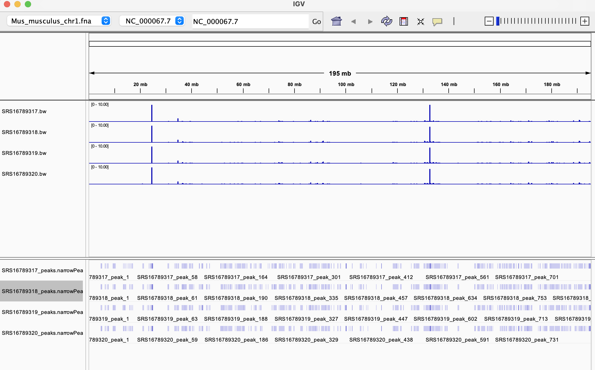
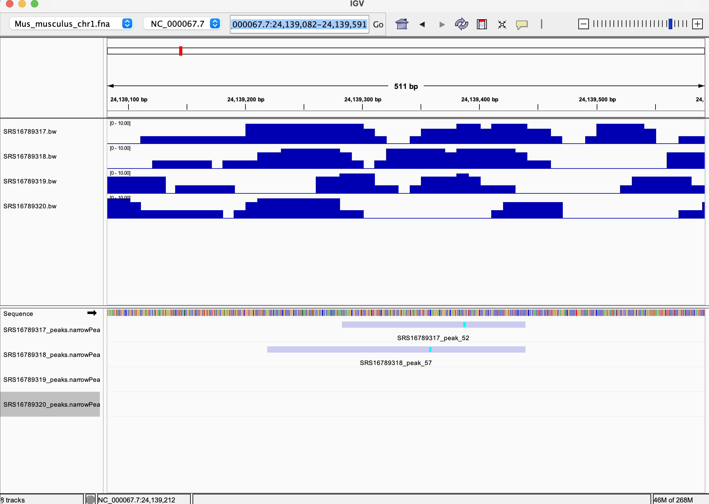

# Mouse ATAC-seq Peak-Calling Pipeline

A Makefile-driven pipeline for analyzing paired-end ATAC-seq data from mouse samples. The pipeline downloads sequencing reads from NCBI SRA, aligns them to a selected mouse chromosome using BWA, identifies accessible chromatin regions using MACS3, and generates coverage tracks for visualization in IGV.

The pipeline supports single-sample and multi-sample processing using GNU Parallel. Users can specify which chromosome to analyze, the number of sequencing read pairs to use, and the number of samples to process concurrently.

## 1. BioProject summary

| Field | Value |
|---|---|
| BioProject accession | PRJNA935800 |
| Organism | *Mus musculus* |
| Reference assembly | GRCm39 (`GCF_000001635.27`) |
| Experimental comparison | Influenza A virus-infected vs. control mouse samples |
| Samples selected | 4 (2 per condition) |
| Assay | ATAC-seq |

## 2. Environment setup

Create and activate the project environment:

```bash
conda env create --prefix ./.bioinfo-env --file environment.yml
conda activate ./.bioinfo-env
```

The environment needs `sra-tools`, `bwa`, `samtools`, `macs3`, `deeptools`, `seqtk`, `parallel`, `curl`, `gzip`, and Python. `bedtools` is useful for replicate comparisons. 

## 3. Download and prepare the design file

```bash
make download-design BIOPROJECT=PRJNA935800
```

The resulting `design.csv` must contain `Run` and `Sample` (or `BioSample`) columns. Add or retain a `Group` column identifying infected and control samples, and select the appropriate two replicates per group. 

## 4. Workflow

1. Download the GRCm39 reference genome once.
2. Extract the selected chromosome and create its BWA and FASTA indexes.
3. Download paired-end SRA FASTQs using `fastq-dump`, with `--split-files --gzip` to produce compressed mate files. 
4. For numeric limits, run the existing `seqtk` subsampling step with a fixed random seed on the downloaded reads.
5. Align reads to the chromosome-specific reference using BWA-MEM.
6. Filter and index BAM alignments using samtools.
7. Call accessible chromatin peaks using MACS3 (`BAMPE`; default q-value 0.01).
8. Count per-sample peaks and generate CPM-normalized bigWig tracks for IGV.

## 5. Run the pipeline

**One sample:**

```bash
make all SRR_ACCESSION=SRR23500889 CHROMOSOME=chr1 MAX_READ_PAIRS=1000000
```

**Four samples sequentially:**

```bash
make design parallel=1 N=4 CHROMOSOME=chr1 MAX_READ_PAIRS=1000000
```

**Four samples, two concurrently:**

```bash
make design parallel=2 N=4 CHROMOSOME=chr1 MAX_READ_PAIRS=1000000
```

**Choose a different chromosome:**

```bash
make design parallel=2 N=4 CHROMOSOME=chr2 MAX_READ_PAIRS=1000000
```

**Use all read pairs instead of a subset:**

```bash
make design parallel=1 N=4 CHROMOSOME=chr1 MAX_READ_PAIRS=all
```

`parallel` is the maximum number of simultaneous sample jobs; `N` is the number selected from `design.csv`; and `CHROMOSOME` identifies the target chromosome. `MAX_READ_PAIRS` (default 1,000,000) sets the maximum SRA spot ID downloaded through `fastq-dump -X` and caps the read pairs used for alignment. For paired-end runs, the default selects the first 1,000,000 spots, rather than a random sample across the full run. The subsequent `seqtk` step uses `SUBSAMPLE_SEED` (default 42); when all downloaded pairs fit within the limit, it retains them all.

Existing FASTQs are reused. Before increasing `MAX_READ_PAIRS` or switching to `all`, remove the affected sample's cached FASTQs and subset files so Make downloads enough reads. Use `make clean` for a complete restart; it also removes all generated reference and analysis outputs.

## 6. Results and output files

For chromosome 1 with 1,000,000 read pairs and seed 42, outputs are stored under chromosome- and read-limit-specific paths:

```text
align/chr1/reads1000000_seed42/<SAMPLE>.bam
peaks/chr1/reads1000000_seed42/<SAMPLE>_peaks.narrowPeak
tracks/chr1/reads1000000_seed42/<SAMPLE>.bw
reports/chr1/reads1000000_seed42/<SAMPLE>_peak_stats.tsv
```

The `.narrowPeak` file contains MACS3 peak calls; the `.bw` file contains a normalized coverage track for IGV.

### Peak counts

**not measured results**.

| Sample | Condition | Number of peaks |
|---|---|---|
| Infected replicate 1 (SRS16789320) | Influenza A | 920 |
| Infected replicate 2 (SRS16789319) | Influenza A | 890 |
| Control replicate 1 (SRS16789318) | Control | 975 |
| Control replicate 2 (SRS16789317) | Control | 876 |


## 7. Visualize peaks in IGV

Load the matching chromosome reference, each sample's `.bw` coverage track, and `.narrowPeak` peak calls into IGV. 






**Interesting Observation:** The genomic location (NC_000067.7:24,139,082-24,139,591) contains peak in control but not in influenza A infected sample.

## 10. Limitations

- The pipeline aligns reads directly to one chromosome. Reads from other chromosomes may map incorrectly. Whole-genome alignment followed by chromosome extraction is more reliable.
- Subsampling reduces computation but can substantially reduce peak-calling sensitivity and apparent replicate agreement.
- The MACS3 effective genome size is approximated for chromosome-restricted analysis, affecting significance estimates.
- CPM normalization of chromosome-only BAMs is not directly equivalent to whole-genome library-size normalization.

## 10. Cleanup

```bash
make clean
```

This removes generated reference, FASTQ, alignment, peak, coverage-track, and report directories. 
