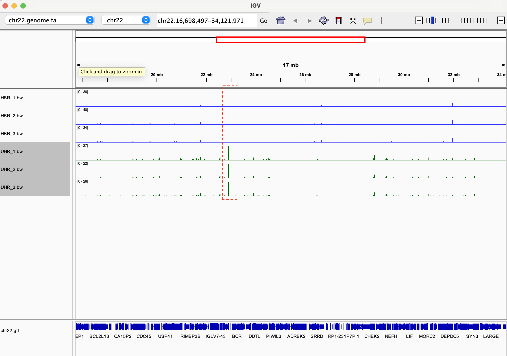
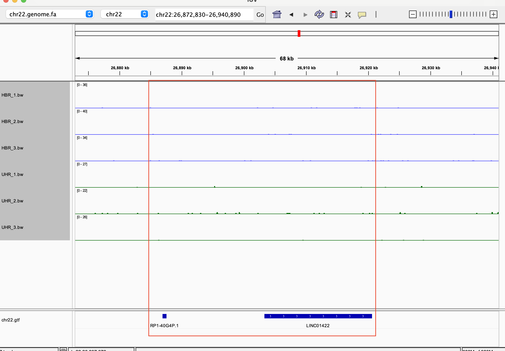
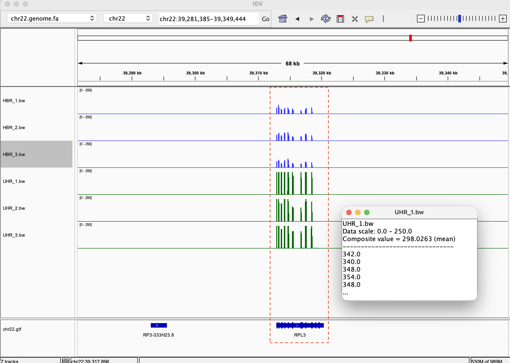
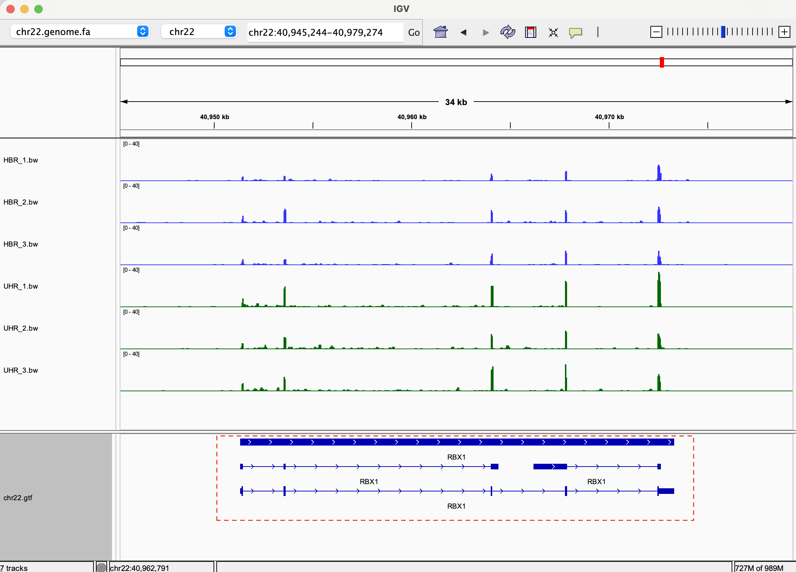

# Evaluate gene expression

This project uses a `Makefile` adapted from the Biostar Handbook by Dr. Albert Istvan to analyze RNA-seq data and compare HBR and UHR samples.

## Reproduce the analysis

Run the analysis for every sample listed in `design.csv`:

```bash
make batch
```

## Visualize the results in IGV

Open IGV and run the command:

```bash
make igv
```

## Questions and observations

* **Look at a wide region (millions of bases wide). How are the two sample types different?**

  The two sample types show different expression patterns in some regions of the chromosome. The highlighted region below shows high coverage in HBR and no coverage in UHR, suggesting higher expression in HBR.

  

* **Navigate across the genome. How consistent are the replicates?**

  The replicates appear consistent overall. Small differences in regions with low coverage may reflect sampling noise.

* **Find a gene that is not expressed in any of the samples.**

  LINC01422 shows no visible expression in any of the samples. This gene encodes a long non-coding RNA (lncRNA).

  

* **Find a gene that is very strongly expressed in all samples. What is its coverage?**

  RPL3 (ribosomal protein L3) is a protein-coding gene with strong expression in all samples. Its coverage is shown below; a numerical coverage value has not been recorded.

  

* **Can you identify the transcripts that are expressed? Sometimes you can only exclude some candidates.**

  The figure below shows three annotated transcripts of RBX1. Coverage alone does not establish which individual transcripts are expressed.

* **Can you find a gene or transcript whose expression clearly differs between the two sample types? What is the fold change?**

  RBX1 appears to have higher RNA-seq coverage in all three UHR replicates than in HBR, suggesting higher expression in UHR. Statistical analysis is needed to assess the significance of this difference.

  The HBR-to-UHR fold change is calculated as `average_expression_HBR / average_expression_UHR`. A value below 1 indicates higher expression in UHR. A numerical fold change has not been calculated here.

  
